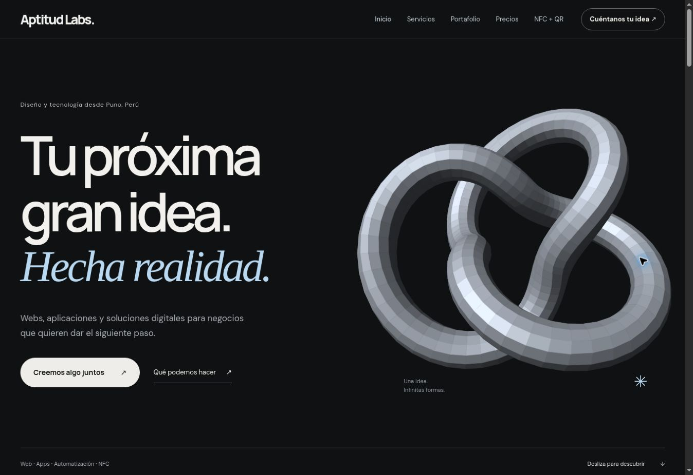
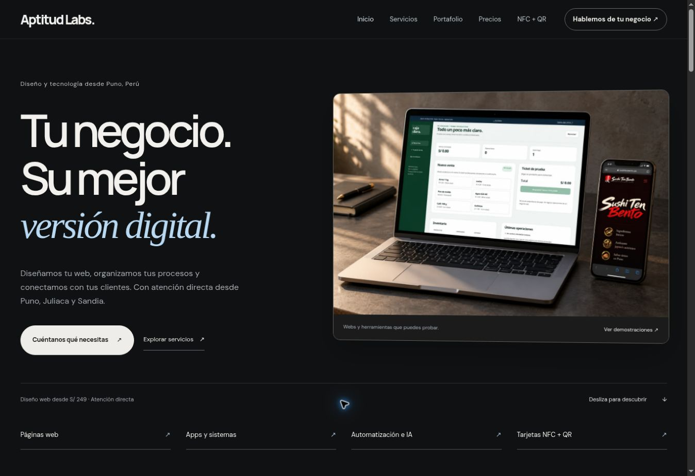
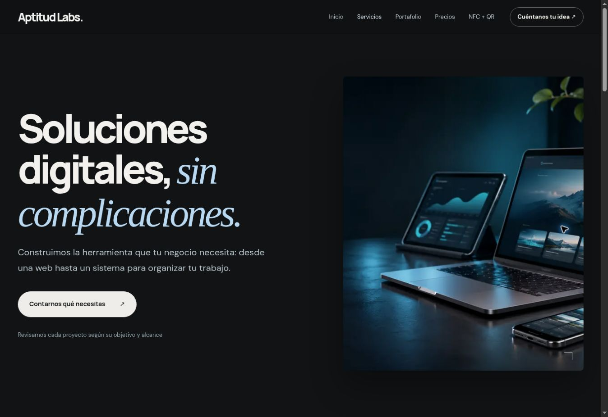
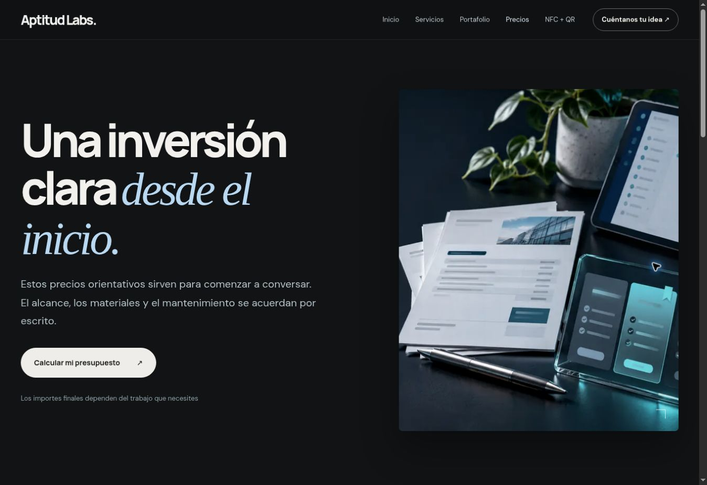
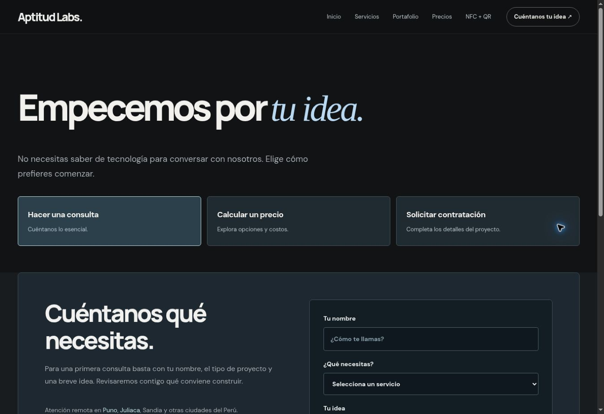
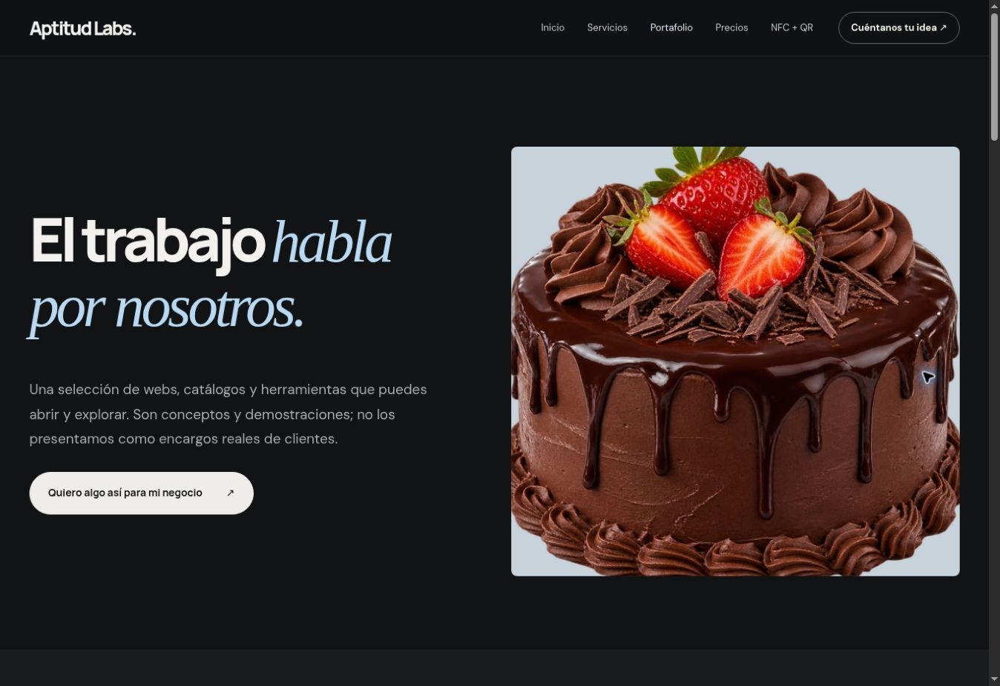
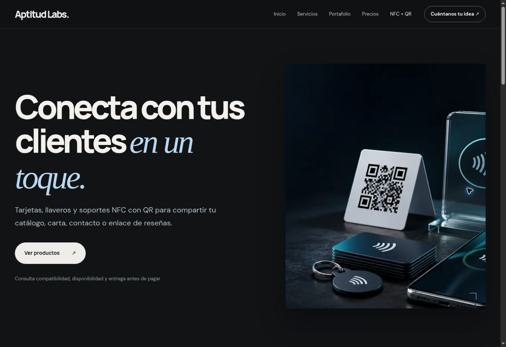
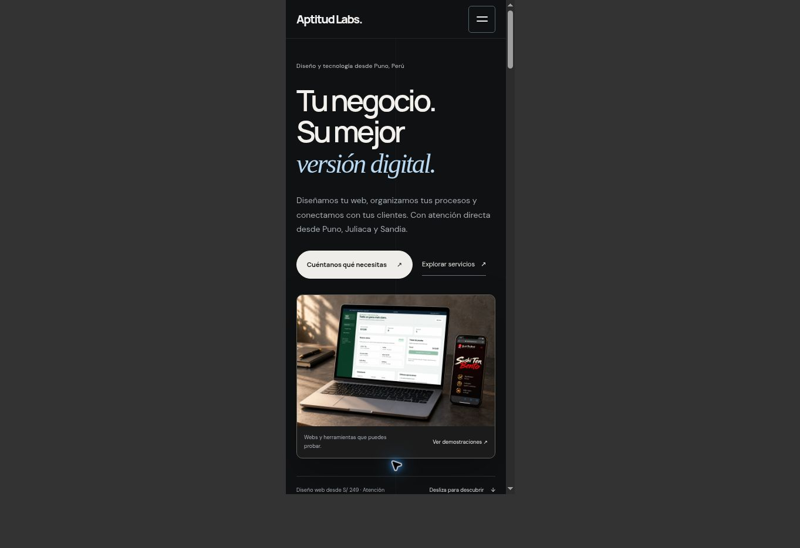

# Aptitud Labs — análisis y mejoras V13

Se revisaron las seis áreas principales del recorrido comercial en la versión publicada. Los cambios se aplicaron a las 12 rutas principales, con una dirección visual común. Las capturas siguientes son de la revisión actual; se descartaron las que todavía estaban cargando imágenes.

## 1. Inicio — presentación más concreta

**Antes:** la pieza 3D atraía la atención pero no explicaba qué se vende. El texto principal era genérico y el precio no aparecía hasta otra página. La animación se renderizaba continuamente.

**Cambio:** montaje fotográfico de laptop y celular con las demos Caja Clara y Sushi Ten Bento; mensaje específico para negocios; enlaces a servicios; tres precios de referencia; muestra web, sistema y NFC con fuentes identificadas. Se quitó la escultura y su bucle de renderizado.

**Estado:** recorrido revisado en escritorio y marcos móviles de 390 y 320 px; escenas y enlaces accesibles. El montaje es una imagen generada con referencias de interfaces existentes, no una fotografía documental de la oficina ni de un cliente.

## 2. Servicios — explicar y demostrar

**Antes:** imagen genérica con brillo azul, gran cabecera y bastante desplazamiento antes de ver servicios. Los enlaces con `?servicio=` no rellenaban la consulta.

**Cambio:** captura de Caja Clara, navegación directa por servicios, captura de la web Maison Dulce y foto ilustrativa del uso NFC. Pulso se describe como ejemplo de seguimiento, sin atribuirle automatizaciones de IA que la demo no demuestra. La consulta recibe el servicio elegido.

**Estado:** destinos locales y preselección de Automatización, bot o IA comprobados.

## 3. Precios — mostrar lo que importa primero

**Antes:** la imagen de papeles y dispositivos ocupaba casi toda la primera pantalla; no se veía ningún importe.

**Cambio:** cabecera breve sin imagen decorativa, acceso directo al simulador, tarjetas alineadas con los precios S/249, S/419 y S/690, alcance y costos adicionales visibles.

**Estado:** el enlace del plan Web Negocio abre el simulador con S/419. Los precios siguen siendo orientativos.

## 4. Contacto — menos fricción

**Antes:** consulta, simulación y contratación estaban disponibles, pero faltaba un acceso directo a WhatsApp junto a la introducción.

**Cambio:** botón de WhatsApp sin formulario obligatorio; elección de proceso conservada; servicio preseleccionado cuando se llega desde su página; tamaños y espacios más compactos.

**Estado:** consulta y configuración comprobadas; no se enviaron mensajes ni solicitudes de prueba a terceros.

## 5. Portafolio — mostrar webs, no solo productos

**Antes:** una fotografía de torta ocupaba la portada; no mostraba el diseño de la web.

**Cambio:** introducción breve, filtros y proyectos antes; captura actual del sitio Maison Dulce en la tarjeta destacada. Se conserva la identificación como demos con datos de ejemplo.

**Estado:** filtro Sistemas muestra Caja Clara y Pulso. Imágenes y destinos locales comprobados; no se ha hecho una auditoría funcional completa de cada demo externa.

## 6. NFC y móvil — caso de uso reconocible

**Antes:** la portada NFC usaba una composición con brillo artificial. Los tamaños generales y cabeceras dejaban el catálogo demasiado abajo.

**Cambio:** imagen ilustrativa de soporte NFC/QR en un café; tipografía y cabeceras más compactas; fichas, personalización y carrito conservados. Texto alternativo y metadatos sociales añadidos a las páginas.

**Estado:** producto WhatsApp + personalización S/3 = subtotal S/28. Se comprobaron diez vistas móviles sin desbordamiento horizontal y el contenido principal del inicio a 320 px. La revisión no sustituye pruebas en teléfonos físicos ni certifica conformidad completa de accesibilidad.

## Verificación

- `python scripts/check-pages.py`: 12 rutas y 372 referencias locales; sin archivos o anclas ausentes, IDs duplicados ni imágenes sin atributo alt.
- `node scripts/check-motion.cjs`: un único estado activo al hacer saltos y desplazamiento inverso; alternativas para movimiento reducido y móvil horizontal.
- Sintaxis JavaScript y `git diff --check` sin errores.
- Revisión visual de portada, escenas, precios, contacto y productos. Filtros, simulador y carrito comprobados sin efectuar envíos ni pagos.

## Activo generado e integrado

Archivo: `assets/real-work/digital-products-hero.webp` (148 KB). Generado con la herramienta integrada de imágenes. Referencias: `assets/projects/caja-cover.webp` y `assets/projects/sushi-ten-bento-cover.png`.

Prompt utilizado:

> Use case: product-mockup. Create ONE premium, photorealistic landscape editorial product photograph, intended to replace an abstract 3D knot in a Peruvian digital studio website hero. 3:2 landscape framing. A real silver thin aluminum laptop open on a charcoal desk, with one dark smartphone standing leaning naturally beside it on the right. The laptop screen MUST display the first supplied reference screenshot, Caja Clara, preserving the recognizable white and forest green interface and Spanish title 'Todo un poco más claro.' as faithfully as possible. The phone screen shows the second reference screenshot, the dark burgundy 'Sushi Ten Bento' restaurant page, fitted naturally to a portrait mobile browser. These are screen content references only; devices are physically real with realistic perspective and reflections. Laptop occupies most of frame, full keyboard and outer corners visible, never cropped. Warm natural side daylight, tangible brushed aluminum, subtle realistic shadows, muted charcoal/stone background, no cyan glow. Slight three-quarter camera angle, camera near desk height, expensive editorial photography with authentic materials and no glossy futuristic vibe. Minimal actual desk objects: closed notebook and pen placed discreetly in background. No humans, no imagined studio interior or office branding. No floating devices, no abstract sculpture, no decorative geometry, no extra captions, no graphics outside the device screens, no watermark. Keep enough margin around laptop to fit a website hero at desktop and mobile. This is an illustrative device mockup using supplied real demo screen content, not a claim about a client or actual workplace. Save generated local image for integration if tool supports that.
