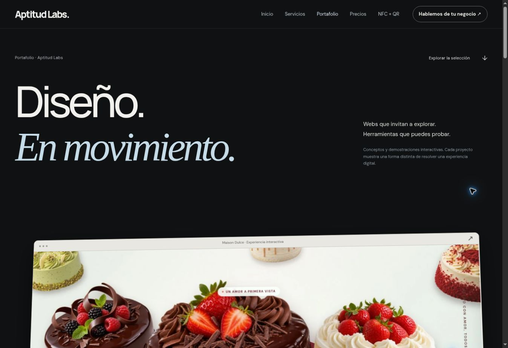
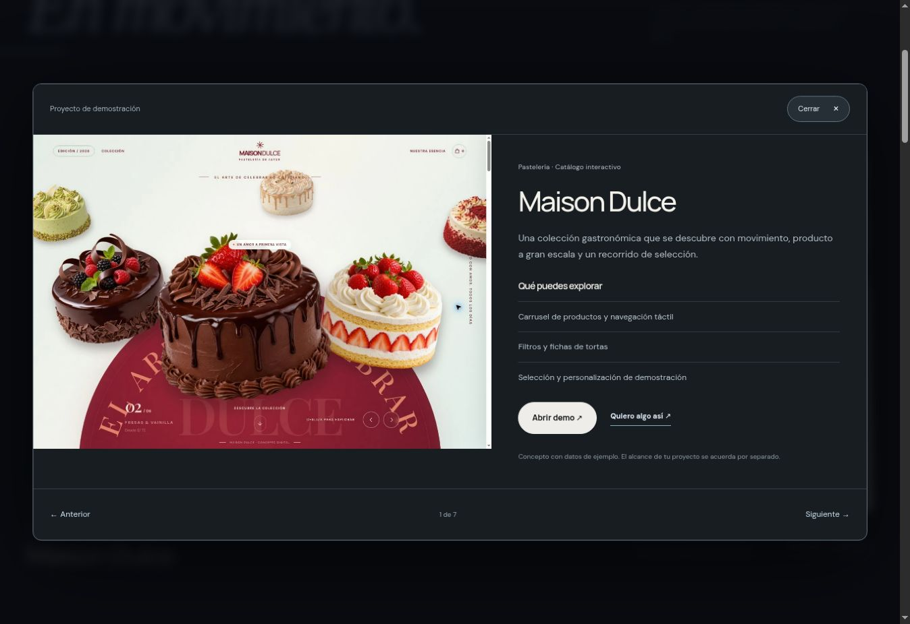

# Portafolio V14

El inicio presenta servicios mediante un ejemplo visual genérico y tres casos de uso; ya no muestra capturas ni nombres de las demos. Las demostraciones viven en `/proyectos/`.

## Diseño del portafolio

- Apertura editorial con título animado, sin duplicar el texto ni usar desenfoque en las transiciones.
- Maison Dulce como pieza destacada a gran tamaño, con perspectiva que se aplana al avanzar por el scroll nativo.
- Galería de otras seis demos con encuadres completos de las interfaces, disposición alternada, entrada al viewport y profundidad al pasar el cursor.
- Fichas nativas de proyecto con imagen, funciones, demo externa, consulta y navegación anterior/siguiente.
- Consulta preseleccionada por tipo de servicio y nombre del proyecto.
- Versiones móviles con ficha desplazable, cierre visible y sin depender del cursor.
- Preferencia de movimiento reducido: sin animaciones ni escena fijada.

## Validación realizada

- Sintaxis de JavaScript y `git diff --check`.
- 12 páginas y 368 destinos locales comprobados por `scripts/check-pages.py`.
- Navegación real por las siete fichas hasta volver a Maison Dulce.
- Filtro Sistemas: solo Caja Clara y Pulso.
- Consulta desde Pulso: `CRM o sistema para negocio` y referencia a Pulso en el texto editable.
- Escape cierra la ficha y devuelve el foco al botón que la abrió.
- Revisión visual de portada, galería y ficha en escritorio y móvil de 390 px; comprobación de límites de contenido a 320 px.
- Se conservan las identificaciones como demos con datos de ejemplo. No se enviaron consultas ni pedidos externos durante las pruebas.

## Imagen del inicio

`assets/real-work/services-example.webp` es un montaje generado con la herramienta integrada de imágenes para ilustrar servicios, sin marcas del portafolio. Prompt: fotografía editorial de laptop y celular físicos en una mesa real, luz natural cálida, ejemplo genérico de web con título «Tu negocio» y ejemplo de «Carta digital», sin marcas existentes, métricas, testimonios, formas abstractas ni brillo artificial. Una segunda edición cambió exclusivamente los precios del menú a S/18, S/15 y S/12. Las capturas de los proyectos del portafolio se conservan como imágenes fuente de las demos existentes.
