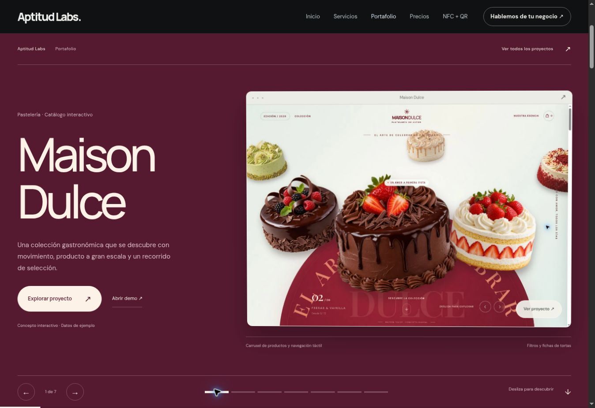
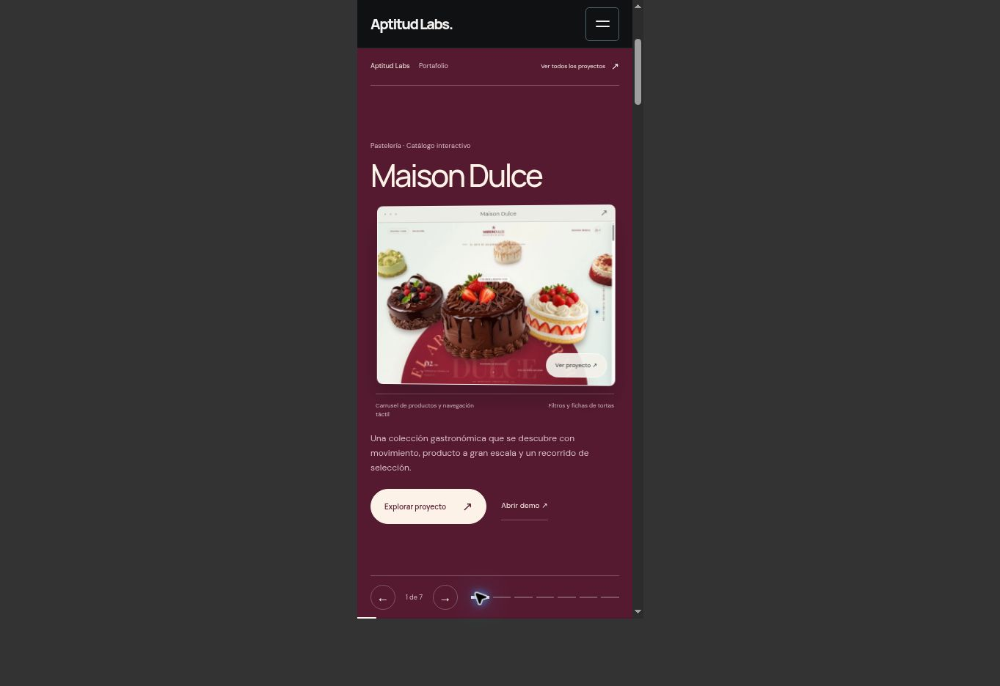

# Portafolio V15 — escenario de proyectos

Se reemplazó la galería de V14 por un escenario que ocupa la altura disponible de la pantalla. Las siete demos tienen una escena propia, paleta vinculada al proyecto y cámara sobre la captura. El inicio y las demás páginas mantienen su función.

- El scroll nativo controla la escena y su perspectiva. Los textos e imágenes anteriores se ocultan antes de revelar los nuevos; se cancelan las animaciones pendientes.
- Se puede recorrer por scroll, botones anterior/siguiente, selector de siete posiciones o índice completo.
- Laptop: título grande, información y captura en paralelo; profundidad al mover el cursor y al desplazarse.
- Celular: nombre, captura, descripción y botones en una composición vertical dentro de la pantalla. Los efectos no dependen de hover.
- Se conservan las fichas accesibles, las demos externas y las consultas con referencia al proyecto.
- Con movimiento reducido o una pantalla de menos de 600 px de alto, se muestran las siete escenas en orden sin fijarlas al viewport.

## Verificación

- `node scripts/check-portfolio-scenes.cjs`: siete escenas, un único estado activo, saltos rápidos, desplazamiento inverso, anterior/siguiente, movimiento reducido y pantalla baja.
- `python scripts/check-pages.py`: 12 páginas y 368 referencias locales correctas, sin IDs duplicados ni imágenes sin alt.
- Sintaxis JavaScript y `git diff --check` correctos.
- Navegación real de las siete escenas en el navegador móvil, apertura de ficha y avance por PageDown. Composición revisada en laptop y en marcos de 390 y 320 px.
- A 320 px se comprobaron título, descripción y controles de cada una de las siete escenas sin recortes fuera del viewport.

